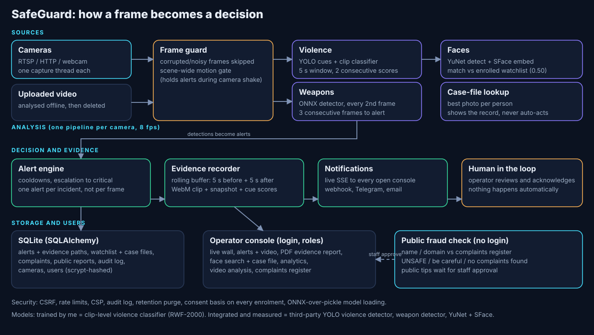

# SafeGuard

AI-assisted video surveillance console: multi-camera live monitoring, explainable violence
detection, consent-based face matching, real-time alerts, analytics and recorded-video analysis,
with authentication, auditing and automatic data retention built in.

> Final-year project · Python · Flask · OpenCV · YOLO

**Author:** Abdul Rafay Khan · BSc (Hons) Computer Science (Online), University of Hertfordshire
**Supervisor:** Justin Mifsud · Module 6WCM0029-0509-2024, Computer Science Project

*Original project report: "SafeGuard: A Real-Time YOLOv8 and CNN-Based System for Weapon, Violence, and Criminal
Detection with Dual Portals for Law Enforcement and Civilian Safety Verification". This repository is the
v2 rebuild; where its measured results differ from the report, the README says so.*

## Features

| | |
|---|---|
| **Live wall** | Several webcams / RTSP / HTTP streams. One capture thread and one analysis loop per camera, shared by every viewer. |
| **Violence detection** | Optional YOLO model fused with motion, person-contact and injury-colour cues into one **explainable** score. Sustained incidents escalate to *critical*. |
| **Watchlist matching** | Face detection (YuNet) + recognition (SFace) against people enrolled **with a recorded legal basis**. Only a face crop and a numeric signature are stored. |
| **Real-time alerts** | Server-Sent Events push alerts to every open console. Optional webhook, Telegram and email. |
| **Video analysis** | Upload a clip, get an incident timeline, peak risk and evidence frames. The upload is deleted afterwards. |
| **Analytics** | Alerts per day / hour, hot-spot cameras, mean time-to-acknowledge, CSV export. |
| **Security** | Hashed passwords (scrypt), lockout, CSRF, rate limiting, strict CSP & headers, roles, audit log, upload validation. |

## Quick start

```bash
python -m venv .venv
.venv\Scripts\activate            # macOS/Linux: source .venv/bin/activate
pip install -r requirements.txt
python scripts/download_models.py # face detection + recognition models (small)
python run.py                     # http://127.0.0.1:5000
```

On first start an **admin** account is created and its random password is printed **once** in the
console. To choose your own, set `SAFEGUARD_ADMIN_PASSWORD` (see `.env.example`).

Add a camera under **Console → Cameras** (use `0` for the built-in webcam), then press *Start*
on the Live wall.

### Enable the trained YOLO violence model (optional, heavy)

```bash
pip install -r requirements-ml.txt   # pulls in PyTorch
```

Put the third-party `Yolo_nano_weights.pt` (see *Third-party models and credits* below) in `models/` and it is picked up automatically. Without it the system runs in
**heuristics-only** mode, and the UI shows that badge, so results are never misrepresented.

## Weapon detection (optional, experimental)

SafeGuard can run a second YOLO model for guns and knives and raise a separate **Weapon** alert.
No weapon weights ship with the repo. Drop a YOLO `.pt` as `models/Weapon_threat_yolov8n.pt`
(or set `SAFEGUARD_WEAPON_WEIGHTS`); classes containing gun / pistol / rifle / knife / grenade count.

**Measured result:** the community model I tried
([Subh775/Threat-Detection-YOLOv8n](https://huggingface.co/Subh775/Threat-Detection-YOLOv8n), MIT) did
**not** detect a real kitchen knife held to a webcam (never as `knife` at conf >= 0.10; one 59% hit in
119 frames at the default cut-off) and repeatedly reported a `grenade` that was not there. Treat
weapon detection as a pluggable slot that needs a better, validated model, not a working feature.
`python scripts/check_weapon_model.py` reproduces this check on your own webcam.

A second candidate ([weapon-detection-yolov11n](https://github.com/The-lucky-Survivor/weapon-detection-yolov11n),
MIT, ONNX, classes knife / pistol / rifle) fared no better: with a real knife in view it never exceeded 39%
confidence, and with **no knife** in the same scene it reported "knife" on 60 detections in 47 frames (up to 64%).
Both models are therefore disabled by default (`SAFEGUARD_WEAPON_ENABLED=false`). A usable detector would need
training on images that look like your own cameras.

### Training our own weapon detector (gun / knife)

**Why community models were not enough.** Scored on held-out frames from the author's own webcam
(67 frames clearly showing a kitchen knife held close to the lens; 176 frames with no weapon: a 100-frame
look-alike-objects session plus the no-knife frames of the knife session; the knife frames were labelled by visual
inspection, so treat differences of a few points as noise; `scripts/weapons/eval_webcam.py`):

| Model | Knife recall @ conf 0.25 | @ 0.40 | False alarms on no-weapon frames @ 0.25 | @ 0.40 |
|---|---|---|---|---|
| Subh775/Threat-Detection-YOLOv8n | 9% | 6% | 3% | 1% |
| weapon-detection-yolov11n (ONNX) | 9% | 6% | 18% | 1% |

Both essentially never find the knife. Their training images are mostly distant CCTV / web photos, not a knife a
few centimetres from a webcam.

**Pipeline (all in `scripts/weapons/`, notebook in `notebooks/`):**
1. `prepare_dataset.py` turns an Ultralytics NDJSON export (here: 35,944 images, classes person / gun / knife /
   stick-rod / weapon) into a clean two-class YOLO dataset: ambiguous `weapon` and `stick-rod` images are dropped, and the
   data is **re-split by source photo**. The export's own split put 1,814 source photos (410 of 1,984 test images, 21%)
   on both sides of train/test via augmented copies, which would inflate any score. It also adds your own webcam
   frames of normal scenes as images with *no* boxes (the export has no negatives at all).
2. `capture_webcam.py` records those frames (`negatives`) and two sets that are **never trained on**:
   `negatives-test` and `knife-test`.
3. `notebooks/train_weapon_detector.ipynb` trains YOLO11n on a free Colab GPU and exports ONNX. ONNX is preferred over
   `.pt` because a pickle can execute code when loaded.
4. `eval_webcam.py` scores any model on the held-out webcam frames; enable a model in the app only if knife recall is high
   and its false-alarm rate is near zero (`SAFEGUARD_WEAPON_ENABLED=true`, `SAFEGUARD_WEAPON_WEIGHTS=...`).

**What we use instead of our own model.** Training was set up but not needed once the pretrained models were tested
fairly on two different kinds of image. Image-level recall on 405 clean-re-split test images from the dataset
(287 with a gun, 192 with a knife; a hit means any matching box above the confidence level, so it is optimistic and these
models may have seen similar images in training) versus the author's close-up webcam frames:

| Model | Gun images @0.25 / @0.50 | Knife images @0.25 / @0.50 | Webcam knife recall @0.25 | Webcam false alarms @0.50 |
|---|---|---|---|---|
| weapon-detection-yolov11n (ONNX) | 72% / 53% | 75% / 64% | 9% | 0% |
| Subh775/Threat-Detection-YOLOv8n | 55% / 36% | 73% / 52% | 9% | 1% |
| stock COCO yolov8n (`knife` class only) | n/a | 2% / 2% | 4% | 0% |

Reading: the community models do find weapons in ordinary photo / CCTV-style images, and they stay quiet on the author's
webcam scene at conf >= 0.5, but they almost never find a knife held a few centimetres from a blurry webcam. Shrinking
the frame onto a larger canvas (zoom-out 1.6x-3x) did not help (recall stayed <= 10%). The app therefore treats
weapon detection as an **optional, experimental** extra:

```bash
python scripts/weapons/download_pretrained.py          # downloads + inspects the ONNX graph; not committed (data licence unknown)
# .env:  SAFEGUARD_WEAPON_ENABLED=true   SAFEGUARD_WEAPON_WEIGHTS=Weapon_yolo11n.onnx
```

A weapon alert needs 3 consecutive frames at >= 0.55 confidence. Do not rely on it for close-up webcams. Training our own
(`notebooks/train_weapon_detector.ipynb`, data pipeline in `scripts/weapons/`) remains available for a camera-specific model.
**Data licence.** The NDJSON export used for the training pipeline states no licence and no source credit; check it
before publishing weights trained on it.

### Performance

Measured on a 12-core CPU, 640x480 frames: the violence model first used ~7 cores because PyTorch spawned a thread per
core and idle OpenMP workers spun. Capping PyTorch to 4 threads (re-applied after every call, because ultralytics
resets it) and `OMP_WAIT_POLICY=PASSIVE` cut that to ~2.2 cores at 107 ms/frame, and the whole server with one camera and
one viewer to ~1-2 cores while still delivering ~5.5 fps (the 6 fps analysis cap). Tune with `SAFEGUARD_TORCH_THREADS`.

**With every model on** (trained violence classifier, YOLO, face detection and the optional ONNX weapon model, one camera
and one viewer) the server uses about **2 cores (~200% CPU)** on a 12-core machine, and a first frame appears about 3 s
after pressing Start (first violence score ~5 s). Two fixes made that possible: ONNX Runtime defaults to one busy-waiting
thread per core and took the whole machine (~1000%), so its session is capped at 2 threads with spinning off and the weapon
model runs on every second analysed frame; and the first prediction of each model triggers a long one-off import chain
(minutes on a cold start), so all models are warmed up in a background thread at boot.

**Live check of the weapon model.** With the camera showing a room, a person standing a few metres away holding a knife
raised a *Weapon detected: knife* alert at 81% confidence, matching the earlier image-level results (works at a normal
distance; fails on a knife held centimetres from a blurry webcam).

**Known limitation:** moving or shaking the camera itself, or large movements right in front of it, can raise
violence alerts (the models never saw camera shake). Calibrate with `SAFEGUARD_CLIP_THRESHOLD` and keep the camera still.

### Hosting a public demo (prepared, not deployed)

`render.yaml` and the Dockerfile are ready for a free Render web service (HTTPS is provided by the host). Steps: push the
repo to GitHub, create a Blueprint in Render from it, and set `SAFEGUARD_ADMIN_PASSWORD` in the dashboard (it is never in
the repo). With `SAFEGUARD_DEMO_SEED=true` the first start fills the public fraud check with the fictional complaints so the
home page works straight away. What the hosted demo does NOT include, on purpose: cameras (a cloud server has none), the
PyTorch violence model (heuristic cues only), the weapon model, and the face-photo demo set (those are photos of real
public figures; do not publish them). The free tier forgets its database on restart. Review the repo for secrets before
making it public: `.env`, `instance/` and model weights are git-ignored and excluded from the image by `.dockerignore`.

### Website demo (`/demo`) and product video

The public site has an interactive replay at `/demo`: five licence-free stock clips play with the **recorded output of the real detectors**
(risk score, people, weapon boxes, alerts), made by `scripts/demo_video/make_replay.py`. Nothing is computed in the visitor's browser, so
it runs on any host, including serverless. The clips were selected because the system works on them; it is a showcase, not a benchmark
(see the evaluation sections for the failures). A 2-minute narrated product tour of the site, `scripts/demo_video/make_saas_video.py`,
is embedded on the same page. Building it exposed a real bug: the community weapon ONNX writes box coordinates as fractions of the image,
which Ultralytics reads as pixels, so every weapon box had zero size (alerts were unaffected, boxes were never drawn). `WeaponBackend`
now decodes those boxes itself.

### Demo video (`docs/demo/`)

A 4-minute narrated walkthrough with two interactive quiz moments, recorded from the live app by `scripts/demo_video/make_demo.py`
(stock footage is served as fake IP cameras by `stream_server.py`; a scripted Chrome session records the screen; Windows speech
narrates; ffmpeg mixes and encodes). `index.html` is a companion page with clickable chapters and the two quizzes; `CREDITS.md`
lists the footage; `LINKEDIN_POST.md` has a post draft and chapter timestamps. Faces are blurred while recording and every record
is fictional. The MP4 is git-ignored (12 MB); regenerate it with the script (needs ffmpeg, Chrome, `pip install -r requirements-demo.txt`).

What the stock clips actually showed (23 free-licence Pexels clips run through the live detectors, `scripts/evaluate_demo_clips.py`,
`docs/evaluation_stock_clips.json`): the violence classifier fired on 7 of 8 sparring clips **and on 5 of 6 calm street clips**; the
weapon model raised alerts on 7 of 9 gun/knife clips, but also on 5 of 8 sparring clips (reading gloves and limbs as pistols or knives) and
1 of 6 calm clips. Re-framing a calm clip (cropping it to fill the tile) changed whether it triggered alerts, so these models are
sensitive to framing and to footage unlike their training data. The clips used in the video were picked from these trial results to
show the software working; the measured accuracy figures are the validation numbers above, not these examples.

## Architecture, deployment, performance and limits

### Architecture



### Run it with one command (Docker)

```bash
SAFEGUARD_ADMIN_PASSWORD=choose-a-password docker compose up --build     # PowerShell: $env:SAFEGUARD_ADMIN_PASSWORD="..."; docker compose up --build
```

Then open http://localhost:5000. Tested on this machine: the image builds in about 4 minutes (794 MB), starts in seconds, uses about 280 MiB of
RAM when idle, `/healthz` answers, the public fraud check works and `/console/` redirects to the login page. The image runs in
heuristics-only mode (no PyTorch violence model, no weapon model; the open face models are downloaded during the build); mount a
`models/` folder or extend the image to enable them. `SAFEGUARD_DEMO_SEED=true` fills the fraud check with fictional complaints.

### Measured performance (and the hardware)

`scripts/benchmark_pipeline.py` loops one clip as a fake IP camera and starts N camera pipelines with production settings (violence
classifier + weapon detector, faces off). **Hardware: Intel Core i5-1235U laptop (10 cores / 12 threads), 7.7 GB RAM, Windows 11, CPU
only** (an NVIDIA MX550 is present but unused). 40 s measured after a 25 s warm-up (`docs/benchmark_pipeline.json`):

| Cameras | Frames analysed per second (total) | Per camera | Mean time per frame | CPU cores used |
|---|---|---|---|---|
| 1 | 5.0 | 5.0 | 190 ms | 1.9 |
| 2 | 4.1 | 2.0 | 475 ms | 2.1 |
| 3 | 2.9 | 1.0 | 1,015 ms | 1.8 |

`ANALYSIS_FPS=8` is a ceiling, not what this laptop reaches. One camera gets about 5 analysed frames per second; each extra camera shares
the same CPU, so with three cameras each one is analysed about once a second. The clip classifier was trained on about 4 samples per
second, so expect weaker detection on busy multi-camera setups; scaling up needs a GPU, a smaller input size or analysing fewer
frames per camera.

### Fraud-check evaluation (precision, recall, class imbalance)

The public fraud check is a name/domain matcher over a complaints register, not a learned model, so I tested it like a classifier
(`scripts/evaluate_fraud_check.py`, `docs/evaluation_fraud_check.json`, fictional demo register of 32 entities):

| Test | Queries | Result |
|---|---|---|
| Flagged business typed as people do (exact, lower/upper case, with or without Ltd/LLC, extra spaces, bare domain, full URL) | 415 | **100% UNSAFE** |
| One-character typos (delete / substitute / swap) of flagged names | 42 | 100% "be careful", none silent, none UNSAFE |
| Businesses whose complaints were all dismissed | 2 | 2 "be careful", 0 UNSAFE |
| Random unrelated names and web addresses | 5,000 | 0 flagged (95% upper bound about 0.06%) |
| Flagged word glued to a different business ("Zenith Plumbing") | 30 | 0 flagged |

Class imbalance: almost every real lookup is for something that is *not* on the register, so accuracy would be misleading. I report
the false-flag rate on 5,000 negatives and the precision you would get if only 1%, 10% or 50% of lookups were flagged businesses
(100% in all three on this data). Caveat: this tests my matching rules on data I generated, so the 100% says the rules do what I
wrote, not that real fraud is caught. The real risk is name collisions: a different legitimate business with an identical name
will be flagged UNSAFE, because a name alone cannot tell them apart. The page therefore shows the case reference and details, says
a complaint is an allegation, and uses a web-address match when one is given.

### Challenges and failures I found (the honest list)

| Finding | Evidence |
|---|---|
| **Phones are read as pistols.** | 4 of 7 stock phone-in-hand clips raised a weapon alert, with "pistol" at up to 79% confidence (`docs/evaluation_challenge_clips.json`). |
| **Low light hurts guns more than knives.** | Simulated low light (darker, noisier): the 2 gun clips went from 2/2 weapon alerts to 0/2; the 2 knife clips stayed 2/2. |
| **Real night footage still false-alarms.** | 4 real night clips with no weapons: 1 raised a weapon alert ("pistol" 67%) and 1 a violence alert. |
| Calm street footage triggers violence alerts. | 5 of 6 calm stock street clips; cropping the same clip changed whether it triggered. |
| Close-up knives are missed. | About 9% recall on my own webcam. A CPU fine-tune on a knife-focused subset (gun/knife classes, 1.5 h) did not fix it: 9% knife recall at 0.25 confidence with 10% false alarms (baseline 18%), and 7% vs 6% at 0.40 (`docs/weapon_webcam_eval.json`). Not adopted. |
| A glitching webcam produced a "rifle". | Fixed with the corrupted-frame guard. |
| The old face threshold matched strangers. | 20% of strangers at 1,000 people enrolled; default raised to 0.50. |
| It does not scale on a laptop. | About 1 analysed frame per second per camera with 3 cameras. |
| Camera-shake protection is unproven. | The scene-wide-motion gate cost 2 real fights on validation and removed no false alarms. |

### Responsible use

* **Consent and authority.** Nobody can be enrolled without a recorded legal or consent basis and an explicit confirmation by an
  administrator; only tight face crops are stored.
* **Access.** Operators see the console; only administrators enrol or remove people or file complaints. Public visitors only get the
  fraud check and cannot see any watchlist data.
* **Audit.** Every face search, enrolment, complaint change, report export and acknowledgement is logged with who and when.
* **Human review.** Nothing happens automatically on a match or an alert; every result is a lead to verify, and the evidence PDF says so.
* **Retention.** Alerts, snapshots and clips are deleted automatically after the retention period.
* **Demo data.** The demo uses fictional records and blurred faces; no real person is shown with an invented record.

**Bias and robustness testing** (`scripts/evaluate_face_groups.py`, `docs/evaluation_face_groups.json`). On Labeled Faces in the Wild
with 1,000 people enrolled (one photo each) at the default 0.50 threshold. The group labels are estimated by a classifier, not
self-reported, and several groups are small, so this is a screening test, not proof of fairness:

| Group (estimated) | Enrolled people correctly recognised | Strangers wrongly matched (95% CI) | Stranger queries |
|---|---|---|---|
| All | 93.6% | 0.30% (0.23-0.39%) | 19,180 |
| Male | 95.1% | 0.20% (0.14-0.29%) | 15,225 |
| **Female** | **88.0%** | **0.68% (0.47-0.99%)** | 3,955 |
| White-appearing | 94.0% | 0.29% (0.21-0.39%) | 14,722 |
| Asian-appearing | 94.7% | 0.40% (0.17-0.92%) | 1,264 |
| **Black-appearing** | 92.7% | **1.29% (0.66-2.53%)** | 618 |
| Child (small sample) | 82.8% | 0.12% (0.02-0.67%) | 845 |

Women were recognised less often and wrongly matched about three times as often as men, and the group estimated as Black-appearing
had the highest false-match rate (wide interval). In the stranger queries about 79% were estimated male and 77% white-appearing, so error rates for
smaller groups are less certain. I did **not** add group-specific thresholds (that would rely on estimated demographics); the
mitigations are the higher default threshold, mandatory human review, and measuring these rates on the population a deployment
would actually see before using it. Image quality also matters (query photos, 1,000 enrolled, 0.50 threshold): recognition was
93.2% on clean photos, 89.9% when darkened, **69.5% when blurred and 67.1% at 48-pixel resolution** (blurred and tiny faces are
mostly rejected, not mismatched: strangers matched stayed at or below 0.3%).

### Third-party models and credits

| Model | Where it comes from | Licence | In this repo? |
|---|---|---|---|
| `Yolo_nano_weights.pt`, YOLOv8-nano fight/violence detector | [Musawer1214/Fight-Violence-detection-yolov8](https://github.com/Musawer1214/Fight-Violence-detection-yolov8): **trained by that repository's author, not by me** | none declared | No: not redistributed, download it yourself |
| Weapon detector (`Weapon_threat_yolov8n.pt`) | [Subh775/Threat-Detection-YOLOv8n](https://huggingface.co/Subh775/Threat-Detection-YOLOv8n) | MIT | No (git-ignored) |
| Weapon detector (`Weapon_yolo11n.onnx`) | community export, see the weapon section | not verified | No (git-ignored) |
| YuNet face detector, SFace face recognizer | OpenCV Zoo (`scripts/download_models.py`) | open licences | Downloaded on demand |

The training record stored inside the violence checkpoint says it was fine-tuned from `yolov8n.pt` (Ultralytics 8.2.90) for 50 epochs at
640 px, batch 16, with a validation mAP@50 of 0.912 (precision 0.846, recall 0.871). That is the original author's run (the file is
byte-identical to the one in their repository, which was created on 2024-09-20). I use it as one cue among several and I did
not train it. If you want to use it, get it from the author's repository and check with them about reuse, since it has no licence.

**What I trained myself:** the clip-level violence classifier (RWF-2000, section above), and, for the original final-year project, a custom
closed-set face CNN (reported in my FYP report as 89.3% accuracy on 302 samples; not re-measured here). The weapon and face-recognition
models above are pretrained and were only integrated and evaluated.

### Corrupted-frame guard

A glitching webcam once sent frames that were mostly digital noise, and the weapon model "found" a rifle in them (7 weapon
alerts and 1 sustained-incident alert out of 104 saved snapshots). `services/framecheck.py` now skips any frame whose
Laplacian variance (a noise measure, taken at 640 px wide) exceeds 3,000 before any model runs, shows "Bad video frame
(ignored)", and logs it. Calibration on those 104 snapshots: normal alert frames scored at most 331, the corrupted ones
9,947 to 67,520, and the new check flags exactly those 8 and no others. Limit of the evidence: that is one camera's
failure mode; an unusually grainy night-time feed could in principle trip it, in which case raise `NOISE_LIMIT`.

### Evidence clips

Every alert now carries a short video: the 5 s before it and 5 s after (`SAFEGUARD_EVIDENCE_BEFORE` /
`SAFEGUARD_EVIDENCE_AFTER`, set both to 0 to disable). Each camera keeps a rolling buffer of its annotated frames as small
JPEGs (about 1 MB for 5 s), so cost is paid once per camera. The clip is encoded to WebM (VP8, plays in current browsers)
on a background thread, attached to the alert, shown in the alert viewer and deleted by the retention policy with the
alert. Clips are recorded at the analysis rate (8 fps), not the camera's full frame rate.

### Evidence report (PDF)

The alert viewer has an **Evidence report (PDF)** button: event, type and severity, time, camera, model confidence, the
"why it fired" cue bars, the snapshot with its SHA-256 (so a printed copy can be checked against the stored file), who
acknowledged it and when, and the handling log. Every export is itself audit-logged. The report states that detections are
automated and need human review.

### Public fraud check (home page, no sign-in)

Anyone can type a business, website or agency name (or a web address) on the home page and see whether complaints
have been filed with law enforcement against it. **UNSAFE** = at least one active complaint on an exact match (same
name, same domain, or a domain whose main word equals the name); **Be careful** = only a near-identical spelling of a
name with complaints, or only dismissed complaints; **No complaints found** = nothing on record, shown with the
reminder that this is not a guarantee of safety. Only aggregate facts about the accused entity are shown (counts,
categories, status, dates, short anonymous summaries); nothing about complainants is stored. Staff file complaints with
`POST /api/complaints` (admin, audit-logged). `scripts/seed_demo_complaints.py` loads **fictional** demo data (invented
names, reserved `.example` domains). Matching is name-based, so common names will collide with real businesses once real
data is used: treat a hit as a reason to look closer, not as proof.

Public reports and the browser shortcut: the home page also has a "Report a business" form (no contact details collected,
5 per hour per address, hidden honeypot field against bots). A report has no effect on any result until an admin approves
it on the Complaints page, which files a normal complaint (audit-logged); rejected tips are kept for the record. A
"Check this site" bookmarklet (drag it to the bookmarks bar) opens the checker for whatever site you are on. Near-identical
spellings of a flagged name show as "Be careful".

### Identifying a person from a photo (watchlist + case files)

Upload a photo on the **Face search** page; the system names the closest enrolled person and shows their case file
(case number, status, aliases, age, nationality, last known location, recorded offences, photos on file). Each person can
have several photos; ranking uses their best-matching photo. `scripts/enroll_demo_dataset.py DATASET_DIR` bulk-enrols a
folder-per-person image set with **invented names and fictional case files** flagged "demo" (real folder names are never
used as labels; the folder-to-name map stays in git-ignored `instance/`). No training is needed: matching uses the
pretrained SFace model, so adding a person is one enrolment, not a retrain.

Measured with `scripts/evaluate_identification.py` on a 54-person, 273-photo set (2-10 photos each; each photo queried
against a gallery that excludes it; 8 photos skipped because no face was detected): **top-1 97.7%, top-3 99.6%**; at the
app's 0.50 threshold it answers 88.7% of queries and is right 100.0% of the time it answers (`docs/evaluation_identification.json`).
These are web-style portraits of public figures; expect lower accuracy on CCTV-quality images, and a match is a lead to verify.

**Strangers and bigger watchlists (this changed the default threshold).** That 97.7% only says the right person is found when
they are enrolled. The worse error in surveillance is a person who is *not* enrolled scoring above the threshold and being shown
with someone's case file. Two measurements (`scripts/evaluate_open_set.py`, `scripts/evaluate_gallery_scale.py`):

*Open set, same 54-person set, half enrolled / half strangers, 30 random splits (4,041 stranger queries):* at the old 0.40
threshold **3.0%** of strangers were wrongly matched (95% CI 2.6-3.6%); at 0.45 and above, 0 of 4,041 (upper bound 0.09%).

*Bigger gallery, Labeled Faces in the Wild, one enrolment photo per person, 9,164 photos of 1,680 people, 5 random draws per size:*

| People enrolled | Top-1 (enrolled people) | Strangers wrongly matched at 0.40 | at 0.45 | at 0.50 | Enrolled people accepted correctly at 0.50 |
|---|---|---|---|---|---|
| 100 | 99.6% | 2.32% | 0.26% | 0.04% | 94.1% |
| 250 | 98.8% | 5.50% | 0.60% | 0.05% | 93.4% |
| 500 | 98.4% | 10.67% | 1.35% | 0.17% | 93.4% |
| 1,000 | 98.0% | 19.95% | 2.47% | 0.31% | 93.5% |

The false-match rate grows roughly in proportion to the number of people enrolled, so the old default of 0.40 would have matched
about one stranger in five against a 1,000-person watchlist. The default is now **0.50** (`SAFEGUARD_FACE_MATCH_THRESHOLD`):
about 0.3% of strangers matched at 1,000 people, at the cost of rejecting about 6% of enrolled faces. Raise it further for larger
lists. Caveats: LFW is mostly well-lit celebrity portraits, so CCTV-quality faces will do worse; and a match is still only a lead.

*Search time (one query, 128-dimension vectors, this laptop):* numpy brute force 0.02 ms at 1,000 vectors, 0.15 ms at 10,000,
2.8 ms at 100,000, 27 ms at 1,000,000. FAISS (flat inner product) was no faster at any of these sizes (0.03, 0.13, 3.1, 29 ms),
so the app keeps plain numpy; an approximate FAISS index (HNSW/IVF) would only be worth adding beyond a few hundred thousand faces.

**Scene-wide-motion gate (added, benefit unproven).** Alerts are held while at least half of the last 5 s of samples
have more than 30% of the picture changing at once (`SAFEGUARD_SCENE_MOTION_GATE`, on by default; the card shows
"Camera/scene motion (held)"). The 30% / half-window values were chosen from the *training* clips only: in RWF-2000
such samples are rare (1.6% of calm rows, 4.2% of fight rows), so the gate costs little there. Measured, production
streaming rule on the 400 validation clips: without the gate 79.0% recall / 80.6% precision (TP 158, FP 38); with it
78.0% / 80.4% (TP 156, FP 38), i.e. it removed 2 real fights and **none** of the 38 false alarms, because RWF has
almost no camera shake to remove. On a synthetic test (real webcam frames shifted randomly each sample, 40 s) the
classifier only fired for 10 px shifts (16 of 304 frames) and the gate did not hold those, since 10 px moves under 30%
of the picture; 30 px and 60 px shifts produced no alerts either way (the gate held 268/304 frames at 60 px). So I could
not reproduce the live false alarms synthetically, and the gate is a safeguard against *large* shakes, not a verified fix
for the alerts seen on the desk webcam. Those still need a per-site threshold or your own recorded negatives.

## Architecture

```
safeguard/
  __init__.py        app factory, security headers, CLI, retention janitor
  config.py          all tunables via SAFEGUARD_* env vars / .env
  models.py          User, Camera, WatchlistEntry, Alert, VideoJob, AuditLog
  blueprints/        web (public) · auth · console (pages) · api (JSON + streams)
  services/
    camera.py        threaded capture, newest-frame-only, auto-reconnect, source validation
    violence.py      cue fusion (noisy-OR) + temporal smoothing + optional YOLO backend
    faces.py         YuNet / SFace, cosine-similarity gallery
    pipeline.py      per-camera analysis loop, MJPEG overlay, cooldowns, escalation
    alerts.py        persistence, snapshot storage, notifications, retention purge
    video_analysis.py offline clip analysis
    events.py        in-process pub/sub → SSE
  templates/ static/ "Obsidian" design system, dependency-free JS and SVG charts
tests/               pytest: security, features, end-to-end pipeline with a fake camera
```

**Flow:** `CameraStream` (thread) → `CameraPipeline` (thread) → annotated JPEG shared by all
MJPEG viewers, plus `Alert` rows → `EventBus` → browsers over SSE.

## Configuration

Copy `.env.example` to `.env`. Notable options: `SAFEGUARD_VIOLENCE_THRESHOLD`,
`SAFEGUARD_ALERT_COOLDOWN`, `SAFEGUARD_FACE_MATCH_THRESHOLD`, `SAFEGUARD_RETENTION_DAYS`,
`SAFEGUARD_COOKIE_SECURE` (enable behind HTTPS) and the notification settings.

CLI: `flask --app run create-user NAME --role operator` · `flask --app run purge`

## Evaluating the detector

`scripts/evaluate_violence.py` scores every video in a labelled dataset (`Fight/` and `NonFight/`
folders, e.g. RWF-2000 or Hockey Fights) and reports accuracy, precision, recall, F1, the confusion
matrix, ROC-AUC and a threshold sweep, both at the production alert threshold and across thresholds:

```bash
python scripts/evaluate_violence.py path/to/dataset --limit 100 --out results.json
```

### Measured results (RWF-2000)

| | Value |
|---|---|
| Data | RWF-2000 `val` split: 200 fight + 200 non-fight clips, never used to choose any setting |
| Settings | YOLO input 640 px, alert threshold **0.20**, 3 consecutive frames, 5 sampled frames/s |
| Threshold chosen on | 200 clips from the RWF-2000 `train` split (precision ~ recall on that set) |
| **Accuracy** | **76.0%** (304 / 400) |
| Precision / Recall / F1 | 78.6% / 71.5% / 0.75 |
| Confusion matrix | TP 143 · FP 39 · TN 161 · FN 57 |
| ROC-AUC | 0.835 |

Raw outputs: [`docs/evaluation_rwf2000_val.json`](docs/evaluation_rwf2000_val.json) and
[`docs/calibration_rwf2000_train_subset.json`](docs/calibration_rwf2000_train_subset.json).
Reproduce with the command above (`SAFEGUARD_VIOLENCE_THRESHOLD=0.20`).

### Trained clip classifier (own model, RWF-2000)

Instead of the hand-weighted cue fusion, a small classifier is trained on per-frame measurements of each clip
(the YOLO model's violence confidence and person count, optical-flow motion statistics, an injury-colour fraction;
see `safeguard/services/clip_features.py`). Pipeline: `scripts/extract_clip_features.py` ->
`scripts/train_clip_classifier.py`. Model family and alert threshold were chosen **only** by 5-fold cross-validation
on the 700 `train` clips; the 400 `val` clips were scored exactly once afterwards.

| RWF-2000 `val`, 400 clips | Accuracy | Precision | Recall | F1 | ROC-AUC |
|---|---|---|---|---|---|
| Hand-weighted fusion (above) | 76.0% | 78.6% | 71.5% | 0.75 | 0.835 |
| **Trained clip classifier** (ExtraTrees, threshold 0.38) | **77.2%** | 73.0% | 86.5% | 0.79 | **0.871** |

Honest reading: with 400 test clips the 95% interval on accuracy is about +/-4 points, so **the accuracy difference
(76.0 vs 77.2) is within noise**. What is clearly better is ranking quality (AUC 0.835 -> 0.871) and recall (71.5% ->
86.5%), at the cost of more false alarms (precision 78.6% -> 73.0%). Cross-validated accuracy on the training clips
(78.0%) agrees with the validation figure (77.2%), so the number is not an artefact of tuning on the test set.
**Live behaviour (the production streaming rule).** In the app the model runs as a rolling 5-second window sampled at
4 measurements/s, re-scored once a second; an alert needs **two consecutive** scores above the threshold. The trained
whole-clip threshold (0.38) turned out to be too eager for that rule: sweeping the threshold with 5-fold out-of-fold
predictions on the **training** clips showed streaming accuracy peaking at **0.50** (80.1%; false-alarm rate on
non-fights 34% at 0.38 vs 17% at 0.50), so 0.50 is the live default (`SAFEGUARD_CLIP_THRESHOLD`; 0 = 0.38).
Replaying each validation clip through that exact class (`scripts/evaluate_clip_streaming.py`):

| Streaming rule on RWF-2000 `val` (400 clips) | Accuracy | Precision | Recall | F1 | TP / FP / TN / FN |
|---|---|---|---|---|---|
| threshold 0.38 (whole-clip value) | 76.8% | 73.4% | 84.0% | 0.78 | 168 / 61 / 139 / 32 |
| **threshold 0.50 (live default)** | **80.2%** | **82.4%** | **77.0%** | **0.80** | 154 / 33 / 167 / 46 |
| hand-weighted fusion (earlier) | 76.0% | 78.6% | 71.5% | 0.75 | 143 / 39 / 161 / 57 |

Transparency: `val` has now been scored several times (whole-clip, streaming at 0.38, streaming at 0.50). The 0.50 value
was **chosen on train only**, but treat the 80.2% as slightly optimistic and note the +/-4 point interval of a 400-clip
test. Live vs offline clip scores agreed to within 0.037 on average over 10 real clips. When `models/violence_clip.joblib`
exists the app uses it automatically (status chip "trained model: on"); otherwise it falls back to the hand-weighted
fusion, and during the first ~2 s of a stream it stays quiet instead. Disable with `SAFEGUARD_CLIP_ENABLED=false`.

### Adapting to your own cameras (site data)

Public clips are street/crowd footage, so ordinary movement in front of a close-up webcam can look violent to the
model. `scripts/record_negatives.py` records *your* normal behaviour as numbers only (no images or video are saved)
and `scripts/train_clip_classifier.py --extra-negatives ...` adds it as non-violent training data (each clip repeated
3x so ~50 clips are not drowned out by ~700). Two separate 2-minute sessions of normal activity (24 clips each) were
recorded, one of them vigorous (stretching, standing up, walking past, waving).

Held-out check (train with session B, test on session A, which was never trained on; live streaming rule):

| Model | RWF-2000 val acc (streaming) | False alarms on held-out site session A |
|---|---|---|
| RWF-2000 only, threshold 0.50 | 80.2% | 5 / 24 clips |
| + session B, own threshold 0.43 | 80.0% | **1 / 24 clips** |

So site data cut false alarms on unseen normal movement by ~80% at no cost on RWF-2000. Caveats: 24 test clips from one
person in one room; the model family also changed (random forest / boosting picked by cross-validation), so not all of
the gain is attributable to the site data; and cross-validation scores are slightly flattering because repeated copies
of a clip can fall on both sides of a fold. The shipped model is then trained on **both** sessions (so no held-out site
data remains for it): random forest, whole-clip validation 80.2% accuracy / AUC 0.882, and under the live streaming rule
at its stored threshold of **0.46: 80.0% accuracy, 80.6% precision, 79.0% recall (F1 0.80; TP 158 / FP 38 / TN 162 /
FN 42)** on the 400 RWF-2000 `val` clips. `val` has been scored several times in this project; the thresholds were not
tuned on it, but treat the figures as slightly optimistic (+/-4 points). Reports: `docs/training_violence_clip_site.json`.
To adapt to your own site: record two sessions, retrain with `--extra-negatives A.npz --site-test B.npz`, and compare.

A "two or more people in view" gate was also tested (train, out-of-fold) and **rejected**: the YOLO model finds 2+ people
in only ~44% of clips, fights and non-fights alike, so the gate cut recall from 89% to 25% for no precision gain.

**Known limitation (observed live).** The model was trained on surveillance-style clips (streets, crowds). On a close-up
desk webcam, vigorous movement near the camera can score near the threshold (two alerts at 0.382 vs 0.38 while moving
about), and the older cue-fusion fallback fired "Aggressive movement" on motion alone. RWF-2000 numbers do not
transfer automatically to your cameras: calibrate per site with `SAFEGUARD_CLIP_THRESHOLD` and, better, record your own normal activity with
`scripts/record_negatives.py` and retrain with `--extra-negatives` / `--site-test`, and review
alerts before trusting it.

Details: [`docs/training_violence_clip.json`](docs/training_violence_clip.json). The 17 MB model file is not committed;
regenerate it with the two commands above.

**Findings along the way**
- The first threshold (0.62) was miscalibrated for this model's scores: it caught 8% of fights (16/200).
  Re-choosing it on the training split, not the test set, lifted recall to 71.5%.
- The original FYP report quotes 88.6-89.8% for this component. I could **not** reproduce that: on
  the held-out validation clips I measure 76.0%. The report's prose metrics (85.3% precision) also
  disagree with its own confusion matrix (89.8%), whose counts (221 fights / 179 non-fights) do not
  add up to RWF-2000's 200 / 200. Treat 76% as this repository's number.
- At the 0.20 threshold, sustained extreme motion on its own can raise a violence alert (the motion cue alone
  can reach about 0.22); the numbers above include that behaviour.
- Clip-level, 5-fps sampling and a single-model-plus-heuristics pipeline; no claim is made about live
  CCTV, other datasets, or weapon / blood detection (see above).

## Tests

```bash
pip install -r requirements-dev.txt
pytest
```

## Docker

```bash
docker build -t safeguard .
docker run -p 5000:5000 -v safeguard-data:/app/instance -e SAFEGUARD_ADMIN_PASSWORD=change-me safeguard
```

Webcam passthrough is host-specific; in containers use RTSP/HTTP sources.

## Responsible use & known limitations

- Violence scores are **probabilistic**. Sports, crowds, red clothing and poor lighting cause false
  alarms; real incidents can be missed. Each alert shows which cues fired.
- A face match is **similarity, not identity**, and accuracy varies with image quality and across
  demographic groups. This project has **not** been benchmarked for bias.
- No automatic action is ever taken on a detection. A human acknowledges every alert.
- Enrol only people you have consent or lawful authority for; surveillance laws vary by jurisdiction.
- Not evaluated for production or enforcement use.

## History

The original prototype lives on the `main` branch. v2 replaced the single 2,000-line `app.py` with the
package above and removed: hard-coded credentials, a `drop_all()` on every start, test endpoints, a
random-number "recognition" fallback, and the celebrity-photo dataset.
